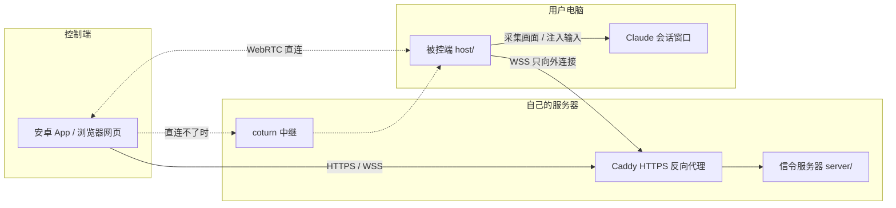
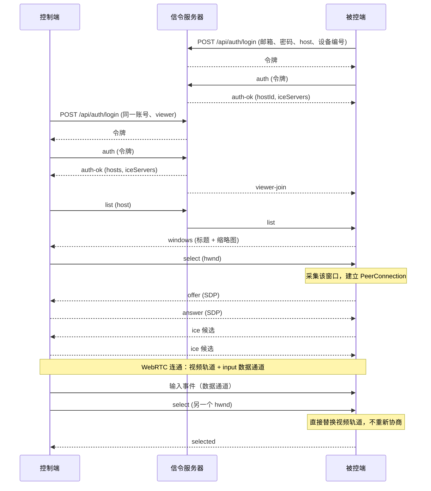

# 02 架构设计

## 总体结构

三个程序，三条通道：

- **账号接口**（HTTPS，信令服务器上的 `/api/auth/...`）：注册、登录、找回密码、退出登录，换到登录令牌。
- **信令通道**（WebSocket，经信令服务器转发）：用令牌鉴权，然后列电脑、列窗口、选窗口、WebRTC 连接协商。服务器按账号配对，只在同一账号内转发。消息量很小。
- **媒体通道**（WebRTC，控制端与被控端之间）：一条视频轨道传画面，一条数据通道传鼠标键盘事件。能直连就直连，直连不了经 coturn 中继。信令服务器不经手画面。

| 组件 | 目录 | 技术 | 职责 |
|---|---|---|---|
| 被控端 | `host/` | Electron 45、koffi 3（调用 Win32） | 账号登录、枚举窗口、采集画面、推流、注入输入 |
| 信令服务器 | `server/` | Node.js 22.13+、`ws`、内置 SQLite、nodemailer | 账号与邮件验证码、按账号转发信令、签发 TURN 临时凭据、托管网页 |
| 网页控制端 | `web/` | 原生 HTML/CSS/JS，无构建 | 注册登录、选电脑、显示画面、采集操作 |
| 安卓控制端 | `android/` | Kotlin、Compose、WebRTC | 同网页控制端，见 [04](04-android-client.md) |

信令服务器的模块（`server/lib/`）：

| 文件 | 职责 |
|---|---|
| `config.js` | 读取和校验配置，限流参数默认值 |
| `store.js` | SQLite：用户、登录令牌、邮箱验证码 |
| `passwords.js` | scrypt 密码散列 |
| `ratelimit.js` | 固定窗口计数器 |
| `mailer.js` | 发信（tencent-ses / smtp / log / memory 四种模式） |
| `auth.js` | 账号服务：验证码、注册、登录、重置密码、令牌校验与作废 |
| `hub.js` | 信令：按账号配对电脑和控制端，转发、广播电脑列表 |
| `http.js` | 账号接口路由和静态文件 |
| `app.js` | 组装以上各部分，供 `server.js` 和测试使用 |

## 连接时序

消息格式见 [03 通信协议](03-protocol.md)。

## 被控端

Electron 分两个进程，按能力分工：

- **渲染进程**（`renderer.js`）：有 WebSocket、窗口采集、WebRTC 编码推流这些现成能力。连接信令服务器，为每个控制端维护一条 `RTCPeerConnection`。
- **主进程**（`main.js` + `win32.js`）：能调用 Win32。负责窗口枚举、生成缩略图、注入输入。所有安全校验放在这里，渲染进程绕不过去。
- **托盘**（主进程）：关闭按钮只把窗口藏到托盘，页面和远程连接照常运行；托盘右键菜单"退出"才真正退出（系统关机、注销时也会正常退出）。托盘图标按连接状态换色，提示文字显示状态和查看中的设备数。
- **账号**（`account.js`，主进程）：登录、退出，设备编号和登录令牌存在 Electron 用户数据目录，令牌用 Windows DPAPI（`safeStorage`）加密。注册和找回密码在网页上完成，被控端只提供跳转链接。
- 两者之间通过 `preload.js` 暴露的调用通信，渲染进程开启沙箱和上下文隔离，拿不到 Node 能力。

### 窗口枚举

`win32.enumTargetWindows`：遍历可见顶层窗口，保留进程可执行文件名在白名单 `targets` 里、标题非空、可见边界不小于 120×120 的窗口。最小化的窗口也保留，选中时再还原。

### 画面采集

- 用 Electron 里保留的旧式约束直接按采集源 id 取窗口画面，不弹系统选择框：`getUserMedia({ video: { mandatory: { chromeMediaSource: 'desktop', chromeMediaSourceId } } })`。
- 采集源 id 的格式是 `window:<HWND 十进制>:0`，可以由窗口句柄直接拼出来，不必先调 `desktopCapturer.getSources`。后者只用来生成列表里的缩略图。
- 采集到的帧尺寸等于窗口的 DWM 可见边界（`DWMWA_EXTENDED_FRAME_BOUNDS`），单位是物理像素。输入坐标换算依赖这一点，已实测吻合。
- 窗口被其它窗口挡住时仍能采集；最小化时不能，所以选中时先用 `SW_SHOWNOACTIVATE` 还原并等 400 毫秒。
- 轨道设置 `contentHint = 'text'`，发送参数设置 `degradationPreference = 'maintain-resolution'`，网络差时降帧率保清晰度。
- 切换窗口时对已有连接调用 `replaceTrack`，不重新协商。

### 输入注入

所有输入事件进入一个串行队列，逐个处理，保证顺序。每个事件的处理步骤：

1. **校验目标**：窗口句柄仍然有效、可见、属于白名单进程。
2. **确保在前台**（移动指针除外）：`SetForegroundWindow` 失败时依次尝试挂接前台线程输入队列、按住 Alt 再切。切换后等 60 毫秒。
3. **命中测试**（鼠标事件）：把窗口内相对坐标换算成屏幕物理像素，用 `WindowFromPoint` 确认该点最上层的窗口就是目标窗口或它弹出的附属窗口，否则丢弃并报 `covered`。
4. **注入**：`SendInput`。鼠标用虚拟桌面绝对坐标（0 到 65535），支持多显示器和负坐标。

几个专门处理：

- **只移动指针不抢前台**。目标窗口不在前台时，移动事件直接忽略。
- **松开按键必须有对应的按下**。每个控制端记录自己按住的鼠标键，断线时自动松开，避免电脑上鼠标键卡住。
- **按键**带扫描码和扩展键标志，否则 Chromium 拿不到正确的 `event.code`，方向键会被当成小键盘键。
- **文字**分两条路：
  - 单行且不超过 40 个字符：按 Unicode 逐字注入，不经过电脑上的输入法。
  - 多行或更长：写剪贴板后发 Ctrl+V。换行按 Windows 约定写成 CRLF。

## 安全模型

能操作 Claude 窗口，等于能让 Claude 在电脑上执行命令。所以安全上把它当成"远程执行"来对待。

| 威胁 | 对策 |
|---|---|
| 别人的账号操作我的电脑 | 服务器按账号配对，只在同一账号内转发；控制端发给电脑的消息要带 `hostId`，服务器只在本账号的电脑里找 |
| 猜密码 | 密码至少 8 位；登录失败按 IP、按邮箱分别计数，15 分钟内错 10 次锁定 15 分钟；用户不存在时也做一次同样耗时的散列，不泄露邮箱是否注册 |
| 冒用别人的邮箱注册 | 注册必须收到邮箱验证码；验证码 6 位、10 分钟有效、错 5 次作废；发送按邮箱和 IP 限频 |
| 数据库泄露 | 密码 scrypt 加盐散列；登录令牌和验证码只存 SHA-256 散列 |
| 设备丢失、密码泄露 | 在设备上退出登录即作废它的令牌；重置密码会作废账号所有令牌，在线连接立即断开 |
| 本机令牌被盗 | 被控端令牌用 Windows DPAPI 加密，只有当前 Windows 用户能解开；安卓端用 Keystore 加密；网页端存在浏览器本地存储（同源隔离） |
| 密码或令牌被窃听 | 公网只走 HTTPS/WSS；服务器默认只监听 `127.0.0.1`，由 Caddy 对外 |
| 借远控操作其它程序 | 白名单进程校验；前台校验；鼠标命中测试 |
| 从公网直接攻击电脑 | 被控端只向外连接，电脑不开入站端口 |
| 网页被注入脚本 | 独立子域名，不与主站同源；严格的内容安全策略，无内联脚本；窗口标题、电脑名用 `textContent` 渲染 |
| 把中继当跳板 | coturn 用临时凭据（24 小时过期），禁止访问内网地址，限制并发分配数 |

当前没有覆盖的风险，后续加固项见 [05](05-handoff-tasks.md)：

- **信令服务器被攻破**：它转发 WebRTC 握手信息、存着账号数据，被攻破后可以冒充任一方。前提假设是服务器由用户自己掌控。
- **没有二次验证**：只知道邮箱和密码就能登录。
- **没有设备管理界面**：看不到账号下登录过哪些设备，只能在设备本身上退出，或者重置密码让全部下线。
- **开放注册的资源滥用**：任何人都能注册并使用中继，流量记在这台服务器上。目前只有 coturn 的并发上限，没有按账号的流量配额。
- **电脑端没有"正在被远程查看"的醒目提示**，只有被控端窗口里的列表。

## 技术选型

| 决策 | 选择 | 理由 | 放弃的方案 |
|---|---|---|---|
| 整体路线 | 自研窗口级远控 | 没有现成开源项目同时满足"只控单个窗口 + 浏览器或手机操作 + Windows" | RustDesk（只能整机）；Happy、HAPI（包的是命令行版 Claude Code，控制不了桌面端窗口）；官方 Remote Control（依赖订阅和 claude.ai 可达） |
| 被控端框架 | Electron | 自带按窗口采集、视频编码、WebRTC，要写的只有窗口筛选和输入注入 | Rust/Go/C# 原生：要自己接采集、编码和 WebRTC 库，工作量大 |
| 调用 Win32 | koffi | 纯 JS 声明，预编译二进制，不用配 C++ 编译环境 | 自己写 Node 原生模块 |
| 账号存储 | Node 内置的 `node:sqlite` | 不用编译原生模块，单文件数据库，备份就是复制文件；Node 22.13 起无需开关 | better-sqlite3（要编译）；独立数据库服务（对单机部署太重） |
| 发信 | 腾讯云邮件推送 API + 审核过的模板（`tencentcloud-sdk-nodejs-ses`）；也支持 SMTP（nodemailer） | 作者手头现成有这套通道（发信域名、地址、模板都审核过），所以先接了它；没有的话用 SMTP 就行 | 只用 SMTP（腾讯云上要另设 SMTP 密码，不确定能否免模板发信） |
| 画面传输 | WebRTC | 浏览器和安卓都有成熟实现，自带拥塞控制、硬件编解码、NAT 穿透 | WebSocket 传 JPEG：简单但延迟和带宽都差；VNC（TightVNC 的单窗口共享有黑屏缺陷） |
| 输入传输 | WebRTC 数据通道 | 与画面同一条路径，延迟低 | 走信令 WebSocket：多绕一次服务器 |
| 中继 | coturn | 事实标准，支持临时凭据 | 自写中继 |

## 开发中踩过的坑

接手开发前请先读这一节，每一条都是实际遇到并已解决的问题。

1. **首次键盘输入时首字被打错**。窗口第一次收到键盘输入时，Windows 要为它初始化输入法，这段时间处理按键很慢。按 Unicode 注入的字符共用一份"当前字符"状态，一次 `SendInput` 灌入整串时，后面的字符会把还没处理的第一个覆盖掉（实测注入"你好X"得到"X好X"）。**解决**：逐字发送，字间隔 8 毫秒；每个窗口第一次按键后等 150 毫秒。见 `host/main.js` 的 `settleKeyboard` 和 `typeText`。
2. **多行粘贴丢换行**。剪贴板里只写 `\n` 时，传统 Windows 输入框不换行。**解决**：写剪贴板前转成 `\r\n`。
3. **`preload.js` 暴露的全局名不能再声明**。`contextBridge.exposeInMainWorld('rc', …)` 之后，页面脚本顶层写 `const rc = window.rc` 会报"标识符已声明"，整个脚本不执行，表现为被控端启动了但连不上服务器。
4. **`requestAnimationFrame` 不可靠**。页面不在前台或被节流时它不触发，用它合并滚动事件会导致事件一直积压。**解决**：改用 16 毫秒定时器。
5. **Electron 运行时下载卡住**。Electron 45 的 npm 包不含运行时，首次运行才从 GitHub 下载，国内网络下会停在 0 字节。**解决**：设置 `ELECTRON_MIRROR=https://npmmirror.com/mirrors/electron/` 后执行 `node host/node_modules/electron/install.js`（安装脚本会校验哈希）。
6. **koffi 3 与 2 不兼容**。3.x 把预编译二进制拆到了子包，指针变成 BigInt。本项目把句柄一律声明成 `uintptr_t` 当数字用，避开指针类型。
7. **从 PowerShell 启动 Electron 看不到日志**。`electron.exe` 是图形程序，`&` 调用不等待也不接输出。**调试办法**：`Start-Process … -ArgumentList '.', '--enable-logging' -RedirectStandardError host.err.log`，渲染进程的控制台输出会进这个文件。
8. **被控端窗口在后台时不能降频**。启动参数里关掉了渲染进程后台节流和窗口遮挡检测，否则被控端窗口被挡住时推流会卡。
9. **同一进程的多个会话窗口要按句柄区分**。所有 Claude 会话共用一个进程号，"是否在前台"必须比较窗口句柄而不是进程号，否则会把输入打到另一个会话里。
10. **Chromium 默认用 mDNS 隐藏局域网 IP**。被控端发出的 host 候选是随机的 `xxx.local` 名字，浏览器能解析，安卓的 WebRTC 原生库解析不了。结果是手机和电脑在同一个 Wi-Fi 下也直连不上，只能绕道中继。**解决**：被控端启动参数里关掉 `WebRtcHideLocalIpsWithMdns`，见 `host/main.js`。被控端是自己的程序，候选只发给自己的控制端，不需要隐藏。
11. **TextureView 改尺寸时会重设缓冲区**。控件尺寸一变（键盘弹出、旋转），TextureView 就把 SurfaceTexture 的缓冲区改回控件大小，安卓端"按视频原始分辨率渲染"的设定随之失效。**解决**：在 `onSurfaceTextureSizeChanged` 里改回视频分辨率并重建 EGL 表面，见 `android/.../video/VideoTextureView.kt`。
12. **不能靠"分辨率变化"判断画面已出来**。断线重连后新画面的分辨率常和之前一样，渲染控件不会再报变化，"正在连接画面…"的提示会一直盖在画面上。**解决**：每条新视频轨道上挂一个只等第一帧的接收端，见 `android/.../rtc/FirstFrameProbe.kt`。

## 已知限制

见 [README](../README.md) 的"已知限制"一节。架构层面最主要的两条：

- 输入必须在前台注入，所以远程操作会打断电脑前的人。要做到完全后台操作，需要换成往窗口直接投递消息的方式，对 Chromium 窗口的兼容性需要专门验证。
- 按窗口采集看不到独立弹窗（系统右键菜单、文件对话框）。
